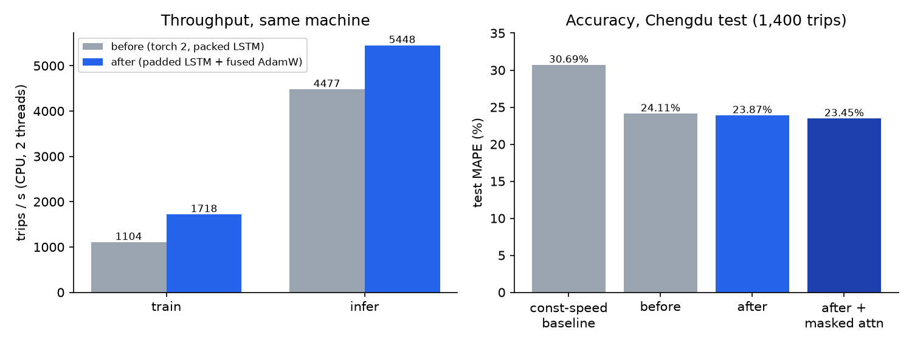
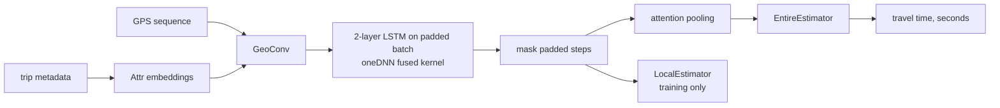

# deeptte-pytorch2

[](https://github.com/PeterP22/deeptte-pytorch2/actions/workflows/ci.yml)

This repo ports [DeepTTE](https://github.com/UrbComp/DeepTTE) (Wang et al., AAAI 2018) from end to end. The model estimates taxi travel time from a GPS trace, and the port moves it to Python 3 and torch 2.14, tuned for CPU.

**Training on CPU runs 1.56x faster (1,104 to 1,718 trips/s on the same machine), and test MAPE is 23.87%.** The constant-speed baseline scores 30.69%, and the pre-upgrade code scores 24.11% when retrained under the same settings.





## Key decisions

- **The LSTM runs on the padded batch instead of a PackedSequence.** This lets oneDNN run one fused kernel, and padded steps are masked afterwards. A test checks the outputs match the old packed path to within 1e-5. The speedup comes from this change.
- **Fused AdamW and a typed train/eval loop.** `train_one_epoch` and `evaluate_loss` return an `EpochStats`, and inference runs under `torch.inference_mode`. Per-epoch throughput and learning rate are logged to `metrics.csv`.
- **The benchmark runs in CI, not on a laptop.** The before and after code are measured in one GitHub Actions job on the same CPU, and the JSON is committed under [benchmarks/](benchmarks/).
- **What didn't work:**
  - bf16 autocast doesn't run at all on the AMD EPYC benchmark runner, because oneDNN has no bf16 LSTM there; the error is recorded in `benchmarks/speed-*.json`. On CPUs where it did run, it was slower than fp32, so fp32 stays the default.
  - `torch.compile` of the whole training step recompiles for every sequence length. Compiling only the heads ran 2% slower than plain fused (1,676 vs 1,718 trips/s).

## Results

The data is the Chengdu sample, tested on 1,400 trips. All runs used CPU only, seed 42, a 60-epoch cap with early stopping (patience 8), and torch 2.14.1+cpu with 2 threads. The numbers come from [benchmark run 39034019065](https://github.com/PeterP22/deeptte-pytorch2/actions/runs/39034019065); see [benchmarks/RUN.md](benchmarks/RUN.md).

| Model | MAPE | MAE | RMSE | Train trips/s | Infer trips/s | Time to converge |
|---|---:|---:|---:|---:|---:|---:|
| Baseline: constant speed | 30.69% | 6.90 min | 9.30 min | - | - | - |
| Baseline: mean time | 46.23% | 8.77 min | 10.78 min | - | - | - |
| Before (e6395f5, packed LSTM, unfused AdamW) | 24.11% | 5.76 min | 7.62 min | 1,104 | 4,477 | 865 s (60 epochs) |
| **After (padded LSTM + fused AdamW)** | **23.87%** | 5.78 min | 7.68 min | **1,718** | **5,448** | 472 s (49 epochs) |
| After + `--masked-attention` | 23.45% | 5.74 min | 7.59 min | - | - | 334 s (46 epochs) |

Throughput is the median of 3 runs, with before and after measured on the same machine (an AMD EPYC 7763). Each training job ran on its own runner, so read the convergence times as indicative. The long-form write-up, with the Porto results, the label-leakage incident and the serving console, is in [docs/guide.md](docs/guide.md).

## Quickstart

```bash
uv sync && uv run pytest
uv run python -m deeptte.train --epochs 60 --device cpu --threads 2
uv run python -m deeptte.evaluate --checkpoint checkpoints/chengdu/best.pt --device cpu
```

Credit for the model design and the Chengdu sample data goes to the original authors. Please cite:

```bibtex
@inproceedings{wang2018when,
  title={When Will You Arrive? Estimating Travel Time Based on Deep Neural Networks},
  author={Wang, Dong and Zhang, Junbo and Cao, Wei and Li, Jian and Zheng, Yu},
  booktitle={AAAI},
  year={2018}
}
```

The upstream code ships without a licence, so this port doesn't add one.
